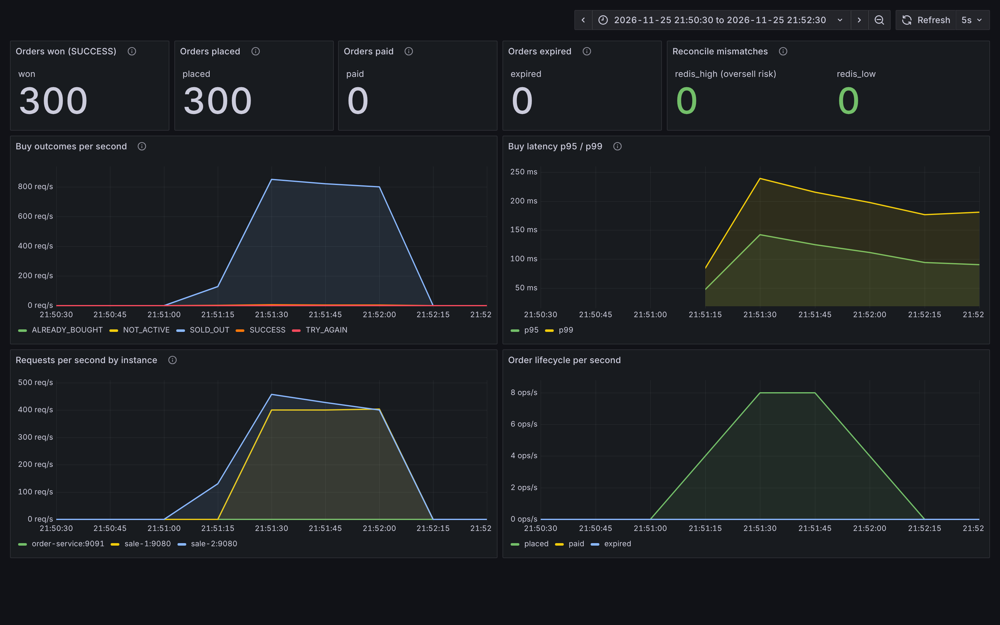
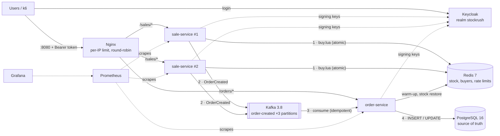
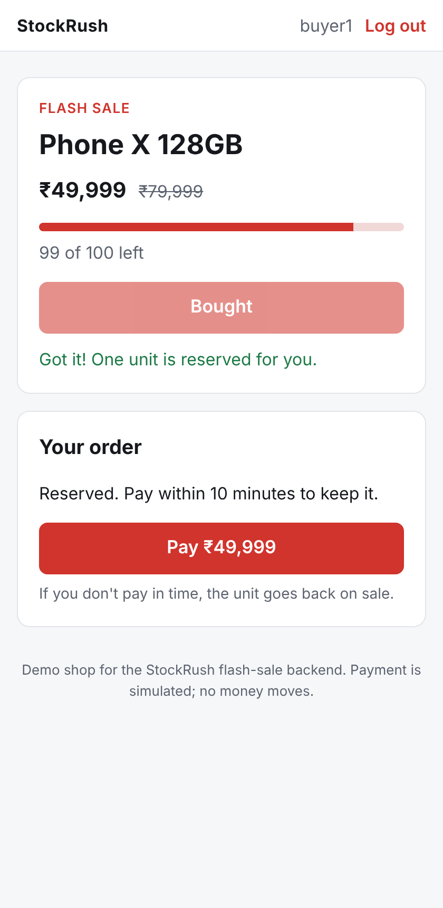
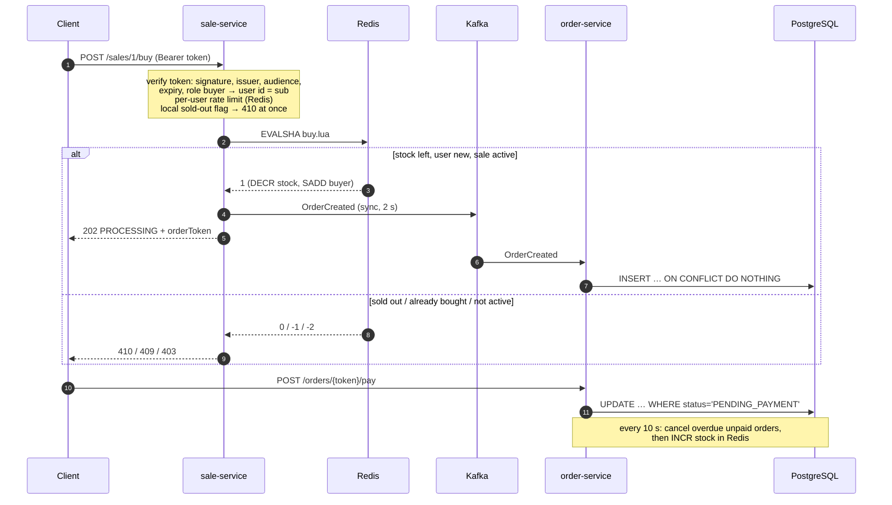
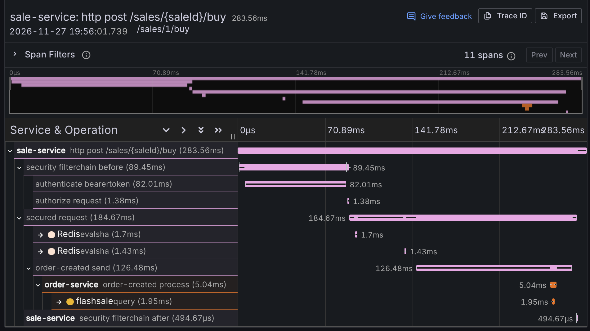

# StockRush

High-concurrency flash-sale backend that never oversells: atomic Redis Lua stock control, Kafka async order pipeline, Spring Boot microservices, and PostgreSQL, load-tested with k6 and monitored in Grafana.

> **20,000 buy attempts from 20,000 users against 100 units: exactly 100 orders, three runs in a row.**
> Every request carries a verified Keycloak-style JWT: up to 3,300 requests/s, p95 658 ms, zero errors, on a single 4-vCPU machine that also ran k6 and the whole stack (5,900 requests/s before authentication was added).
> Details: [docs/loadtest-results.md](docs/loadtest-results.md).



## Contents

- [What it does](#what-it-does)
- [Architecture](#architecture)
- [Run it](#run-it)
- [Request flow](#request-flow)
- [Design decisions and trade-offs](#design-decisions-and-trade-offs)
- [Failure scenarios](#failure-scenarios)
- [Results](#results)
- [Monitoring](#monitoring)
- [Security](#security)
- [Limitations and next steps](#limitations-and-next-steps)

## What it does

Thousands of users try to buy a small, fixed stock at the same instant. The system must:

1. **Never oversell.** Exactly N orders for N units, under any load.
2. **Allow one purchase per user per sale.**
3. **Survive the spike.** The database never sees the raw traffic.
4. **Release unpaid stock.** Orders not paid within a timeout are cancelled and the unit goes back on sale.
5. **Be observable and provable.** Metrics in Grafana, and a k6 load test that proves rule 1.

The full specification is [ARCHITECTURE.md](ARCHITECTURE.md).

## Architecture



| Component | Role |
| :-- | :-- |
| **Keycloak** | Identity provider. Users log in here and get short-lived access tokens; both services verify them. Roles: `buyer`, `admin`. |
| **Nginx** | The only public entry point. Round-robins `sale-1`/`sale-2`, routes `/orders/*` to order-service, rate-limits buys per IP, and refuses every other path (`/admin`, `/actuator`). |
| **sale-service** (×2) | Stateless buy path. No database connection. Runs the Lua script, publishes `OrderCreated` to Kafka, rate-limits per user. |
| **Redis** | Hot state: remaining stock, the set of buyers, the sale window, rate-limit counters. AOF persistence. |
| **Kafka** | Buffers accepted purchases so PostgreSQL absorbs them at its own pace. |
| **order-service** | Owns PostgreSQL. Idempotent consumer, order status and mock payment, payment-timeout worker, reconciliation job, admin warm-up/reset. |
| **PostgreSQL** | Source of truth for orders. |
| **Prometheus + Grafana** | Metrics and the provisioned dashboard above. |

Tech: Java 17, Spring Boot 4.2, Spring Security (OAuth2 resource server), Keycloak 26, Redis 7.4, Kafka 3.8 (KRaft), PostgreSQL 16, Nginx 1.27, Docker Compose, k6, Micrometer, OpenTelemetry, Grafana Tempo 2.8, Prometheus 3.5, Grafana 12.

## Run it

Requires only Docker (with Compose). The Java services are compiled inside Docker; no local Java or Maven is needed to run the project.

```bash
cp .env.example .env              # then change the passwords in .env
scripts/dev-cert.sh               # local CA + certificate for https://localhost:8443 (git-ignored)
docker compose up -d --build
```

Open the sale (the shop admin warms it up: loads the stock into Redis and sets its time window):

```bash
curl -X POST -H "Authorization: Bearer $(scripts/token.sh shopadmin)" localhost:8090/admin/sales/1/warmup   # → {"saleId":1,"stock":100}
```

Then open the shop page at **https://localhost:8443** (your browser trusts it once you import `infra/tls/ca.crt`, or click through the warning) and log in as `buyer1` or `buyer2`, password `DEMO_USER_PASSWORD` from `.env`. The page shows live stock, buys, waits for the order and lets you pay (simulated). https://localhost:8443/?sale=2 is the sale sold through the [waiting room](#waiting-room-optional-per-sale): the page queues you and buys automatically when you are admitted (warm sale 2 up first).



> Already ran StockRush before the shop page existed? Keycloak keeps its realm, so point the web login at the page once: `scripts/keycloak-web-client.sh`.

The same with curl, as the demo users (`buyer1`, `buyer2`, `shopadmin`; password `DEMO_USER_PASSWORD` from `.env`):

```bash
BUYER=$(scripts/token.sh buyer1)

curl --cacert infra/tls/ca.crt -X POST -H "Authorization: Bearer $BUYER" https://localhost:8443/sales/1/buy                 # → {"status":"PROCESSING","orderToken":"…"}
curl --cacert infra/tls/ca.crt -H "Authorization: Bearer $BUYER" https://localhost:8443/orders/<orderToken>                 # → {"status":"PENDING_PAYMENT"}
curl --cacert infra/tls/ca.crt -X POST -H "Authorization: Bearer $BUYER" https://localhost:8443/orders/<orderToken>/pay     # → {"status":"PAID"}
curl --cacert infra/tls/ca.crt https://localhost:8443/sales/1/stock                      # → {"stock":99} (public)
```

Tokens last 5 minutes; run `scripts/token.sh` again when you get a 401.

| URL | What |
| :-- | :-- |
| https://localhost:8443 | Shop page and API (Nginx, TLS 1.2/1.3); http://localhost:8080 redirects here |
| http://localhost:8090 | order-service admin (host only) |
| http://localhost:3000 | Grafana (user `admin`, password `GRAFANA_ADMIN_PASSWORD` from `.env`) |
| http://localhost:9090 | Prometheus |
| http://localhost:3000/explore | Traces: Explore → **Tempo** (search, TraceQL, service graph) |
| http://localhost:9093 | Alertmanager (alerts: oversell risk, service down, dead-lettered events, errors, latency, consumer lag) |
| http://localhost:8180 | Keycloak (admin console: `admin` / `KEYCLOAK_ADMIN_PASSWORD` from `.env`) |

The database schema comes from Flyway migrations in `infra/db/migration`, applied automatically by the one-shot `db-migrate` container on `docker compose up`; new migrations apply to an existing database without losing data. If you ran a version of this repo from before migrations existed, recreate the database once (`docker compose down -v`).

### Run the load test

The load test needs 20,000 different authenticated users, and logging 20,000 people into Keycloak is not the point of the test. So the load-test override does two things: it turns off the per-IP limit in Nginx (all k6 traffic is one IP), and it lets the services also accept tokens that k6 signs itself as the `stockrush-loadtest` issuer, with `LOADTEST_JWT_SECRET` from `.env`. The normal stack never trusts that issuer.

```bash
docker compose -f docker-compose.yml -f docker-compose.loadtest.yml up -d
set -a; . ./.env; set +a
curl -X POST -H "Authorization: Bearer $(scripts/token.sh shopadmin)" localhost:8090/admin/sales/1/reset   # TEST ONLY
sleep 6                                             # let the sold-out flags expire
k6 run -e LOADTEST_JWT_SECRET loadtest/flash-sale.js
# or, without installing k6:
docker run --rm -i --network host -e LOADTEST_JWT_SECRET -v "$PWD/loadtest:/scripts:ro" grafana/k6:1.2.0 run /scripts/flash-sale.js
```

The run passes only if exactly 100 attempts win and nothing returns an unexpected status. Go back to the normal stack afterwards with `docker compose up -d`.

### Tests

```bash
# Running the tests needs JDK 17 (set JAVA_HOME to it), `unzip`, and Docker for Testcontainers.
(cd sale-service && ./mvnw verify)     # includes a Testcontainers race: 200 buyers, 10 units, exactly 10 winners
(cd order-service && ./mvnw verify)    # idempotent consumer, payment, timeouts, reconciliation on real PostgreSQL + Redis
```

CI runs both on every pull request, plus CodeQL.

## Request flow



## Design decisions and trade-offs

### Stock: one Lua script in Redis

The whole decision — is the sale open, has this user bought already, is there stock, take one — runs as a single Lua script. Redis executes scripts atomically, so no two buyers can ever see the same last unit. It is the **only** place stock is decremented.

| Approach | Why not (for this workload) |
| :-- | :-- |
| `SELECT … FOR UPDATE` on a stock row | Correct, but every buyer queues on one row lock in PostgreSQL. Thousands of requests per second on a single hot row means long lock waits, exhausted connection pools and timeouts. The database sees the raw spike, which is exactly what rule 3 forbids. |
| Optimistic locking (`UPDATE … WHERE version = ?`) | No lock waits, but under contention almost every attempt loses the race and retries. Retry storms multiply the load at the worst moment, and it still runs on the database. |
| Read stock in Java, then write | Two requests can both read "1 left". This is the classic oversell bug. |
| **Redis Lua (chosen)** | In-memory, single-threaded, atomic. About one network round trip per attempt, no locks, no retries, and the database never sees losing attempts. The trade-off: Redis becomes the authority during the sale, so it runs with AOF persistence, and a reconciliation job checks it against PostgreSQL. |

The script uses Redis's own clock (`TIME`) for the sale window, so the two sale-service instances can never disagree about whether the sale is open.

### Why Kafka between the buy and the database

A buy is accepted the moment Redis says yes; writing the order can happen a few milliseconds later. Kafka decouples the two: a burst of winners becomes a steady stream the database absorbs at its own pace. If PostgreSQL is slow or briefly down, orders wait in Kafka instead of failing the buyer. The producer is idempotent with `acks=all`, and the send is synchronous (2 s), so a `202` means the event is durably in Kafka.

### Idempotency everywhere

Delivery is at-least-once, so every write tolerates repeats:

- The consumer inserts with `ON CONFLICT DO NOTHING` on `order_token` and on `(sale_id, user_id)`.
- Payment and cancellation are single conditional updates (`WHERE status = 'PENDING_PAYMENT'`). A user paying at the same moment the timeout fires: exactly one wins.
- Never "read the row, decide in Java, write it back".

### The local sold-out flag

Once a sale-service instance sees "sold out", it answers further requests with `410` from memory, without calling Redis. In a flash sale almost every attempt is a loser (19,900 of 20,000 in the load test), so after the last unit goes, Redis stops seeing the flood. Because stock can come back (failed Kafka sends, unpaid orders), every flag is cleared every 5 s.

### Releasing unpaid stock safely

The timeout worker cancels overdue orders with one `UPDATE … RETURNING` (batched, `FOR UPDATE SKIP LOCKED` so several instances could share the work), and only **after** that commits does it `INCR` the stock. If the process dies in between, Redis is one unit low: a sale is lost, but nothing is ever sold twice. Doing it the other way round would risk overselling.

### One attempt per user

A user whose order expires stays in the buyers set and cannot buy again in that sale. It keeps the rule simple and stops a user from holding a unit, letting it expire and grabbing it again.

### Waiting room (optional, per sale)

A sale can be sold through a virtual waiting room (demo: sale 2). Buyers `POST /sales/{id}/queue`, poll `GET /sales/{id}/queue` until it says `ADMITTED`, then buy. People who join before the sale opens are shuffled (a lottery, so speed and bots gain nothing); later arrivals queue in order. Every second the next batch is admitted; a buy from anyone not admitted gets `403 NOT_ADMITTED`, checked inside the same atomic Lua script as the stock decrement. In the load test, 200 bots calling buy directly were all refused while exactly 100 of 2,000 queued buyers won. Details: ARCHITECTURE.md §18.

## Failure scenarios

| What fails | What happens |
| :-- | :-- |
| Kafka rejects the send or reports failure | The unit goes straight back (`INCR` stock, remove buyer). Client gets `503 TRY_AGAIN`. |
| Kafka does not answer within 2 s | Client gets `503`, but the unit stays reserved until Kafka gives a final answer (≤ 10 s). Late success → the order is created normally. Late failure → the unit goes back. Never sold twice. Tested by stopping Kafka mid-run. |
| Redis down | `503 TRY_AGAIN` with `Retry-After: 1` within 1 s. No thread hangs. |
| PostgreSQL not up yet when order-service starts (e.g. after a host or Docker restart, when containers come back in any order) | order-service waits up to 60 s for it instead of crash-looping. |
| PostgreSQL down | Orders wait in Kafka. The consumer retries with backoff (0.5 s → 30 s, up to 5 minutes), then catches up. If the outage outlasts that, the events are parked on the dead-letter topic and replayed with one admin call once the database is back. |
| A malformed or unknown-sale event | Parked at once on `order-created.DLT` with its error, so one bad record cannot block a partition. Operators list parked events with `GET /admin/dead-letters` and replay them after fixing the cause with `POST /admin/dead-letters/replay` (safe: the consumer is idempotent). |
| One sale-service instance dies | Nginx sends traffic to the other. A failed connect is retried on the other instance; a request that already reached an instance is never resent, so a buy is never duplicated. Proven by killing `sale-1` mid-sale (below). |
| order-service crashes between cancel and stock restore | Redis is one unit low (safe direction). Reconciliation reports `redis_low`. |
| Redis and PostgreSQL disagree | The reconciliation job (every 60 s) logs and counts it: `redis_high` (oversell risk, ERROR) or `redis_low`. It reports only; it never auto-corrects. |

### Proven under failure (chaos tests)

`chaos/run.sh` kills one component **in the middle of a sale** (1,000 units, 30 new buyers per second), brings it back 15 s later, and then checks PostgreSQL and Redis directly. The checks: no oversell, every buyer told "won" has an order, Redis stock + orders = 1,000, and nothing dead-lettered.

| Killed mid-sale | Buyers told "won" | Orders | Redis left | Result |
| :-- | --: | --: | --: | :-- |
| nothing (baseline) | 1,000 | 1,000 | 0 | all 4 checks pass |
| one sale-service instance | 1,000 | 1,000 | 0 | all 4 checks pass (12 in-flight requests got no answer) |
| Kafka broker | 894 | 894 | 106 | all 4 checks pass (907 buyers refused with 503, units returned) |
| order-service | 1,000 | 1,000 | 0 | all 4 checks pass (orders caught up from Kafka) |
| PostgreSQL | 1,000 | 1,000 | 0 | all 4 checks pass (writes retried until it was back) |
| Redis (SIGKILL) | 1,000 | 1,000 | 0 | all 4 checks pass (stock restored from its append-only file) |

Details, findings and the honest limits (a power loss of the Redis host is not covered): [docs/chaos-results.md](docs/chaos-results.md). Run it with `chaos/run.sh` in load-test mode. CI runs it weekly and on demand.

## Results

| | |
| :-- | :-- |
| Attempts per run | 20,000 (1000 virtual users, every attempt a different user) |
| Stock | 100 |
| Winners per run | **exactly 100**, in every run (3 before and 6 after authentication) |
| Orders in PostgreSQL | 100 per run, Redis stock 0, 100 buyers |
| Errors (5xx or unexpected status) | 0 |
| Throughput, every request authenticated (Step B, warm JVMs) | 2,176 – 3,293 req/s |
| Latency, authenticated | p50 248–345 ms, p95 658–1,138 ms, p99 748–1,611 ms |
| Throughput before authentication (Phase 4) | 4,647 – 5,868 req/s, p95 321–476 ms |
| Load balance | Even split between `sale-1` and `sale-2` |
| Reconciliation mismatches | 0 |

Everything — k6, Nginx, both JVMs, order-service, Redis, Kafka, PostgreSQL, Keycloak, Prometheus, Grafana — shared one 4-vCPU machine (load average 16.8 during the authenticated runs), so the latency figures are a baseline, not a capacity limit. Authentication costs about 40 % of throughput on this box, partly because k6 signs a token per request on the same cores. Full output: [docs/loadtest-results.md](docs/loadtest-results.md).

## Monitoring

Every request gets an id from Nginx, returned as `X-Request-Id` and carried through both services and Kafka, so one purchase can be followed from the Nginx access log to the order being written; the services log JSON (Elastic Common Schema) in Docker.

**Distributed tracing.** Every purchase is also one OpenTelemetry trace across both services, through Kafka. The trace covers the JWT check, the Redis scripts, the Kafka send, order processing and the database write. Traces are stored in Grafana Tempo, which also draws a live service graph. Traces carry no user ids or order tokens, and a test enforces it. Tracing 100% of a 20,000-buyer burst cost about 14% throughput, while 10% sampling cost nothing measurable; load-test mode uses 10%. Details, measurements and how to find a purchase: [docs/tracing.md](docs/tracing.md).



Prometheus scrapes both sale-service instances and order-service on their internal management ports every 5 s. Grafana loads the **StockRush — Flash Sale** dashboard automatically.

| Metric | Meaning |
| :-- | :-- |
| `flashsale_buy_total{result}` | Buy attempts by outcome: `SUCCESS`, `SOLD_OUT`, `ALREADY_BOUGHT`, `NOT_ACTIVE`, `TRY_AGAIN` |
| `flashsale_orders_placed_total` | Orders written by the consumer (duplicates excluded) |
| `flashsale_orders_paid_total` / `flashsale_orders_expired_total` | Payments and timeout cancellations |
| `flashsale_reconcile_mismatch_total{direction}` | `redis_high` (must stay 0) / `redis_low` |
| `flashsale_orders_dead_lettered_total{reason}` | Order events parked on the dead-letter topic, by cause |

Dashboard PromQL:

```promql
# Buy outcomes per second
sum by (result) (rate(flashsale_buy_total[30s]))

# Buy latency p95
histogram_quantile(0.95, sum by (le) (rate(http_server_requests_seconds_bucket{uri="/sales/{saleId}/buy"}[1m])))

# Requests per second by instance
sum by (instance) (rate(http_server_requests_seconds_count{uri!~"/actuator.*"}[30s]))
```

## Security

- **Shop page:** logs in with the authorization code flow and PKCE, keeps tokens in memory only (never in browser storage), sends no cookies to the API, and runs under a strict Content Security Policy (scripts and styles from this server only; network calls only to this server and Keycloak). Plain JavaScript with no third-party code.
- **Identity:** users authenticate with Keycloak. Every protected request carries a short-lived access token whose signature, issuer, audience and expiry are checked; the user id is the token's subject. Buying and orders need the `buyer` role, `/admin/**` the `admin` role. Forged, tampered, expired or foreign tokens get 401.
- Only Nginx is published beyond `127.0.0.1`. It serves HTTPS only (TLS 1.2/1.3, HSTS and strict security headers; plain HTTP gets a 308 redirect) and serves the shop page plus `/sales/*` and `/orders/*`, nothing else.
- Every password comes from a git-ignored `.env`; services refuse to start without them.
- Each service has its own Redis user that can reach only its keys and the exact commands it needs (no FLUSHALL, KEYS or CONFIG); services use a least-privilege PostgreSQL role that cannot change the schema. Schema changes run as a separate owner role in a one-shot migration container, never in the services.
- Containers run as a non-root user with a read-only filesystem, no Linux capabilities and a memory limit.
- `/orders` endpoints only ever show the caller's own orders. The test-only reset endpoint does not exist unless `RESET_ENABLED=true`.
- Input validation, atomic rate limiting, no stack traces in responses, Maven wrapper pinned by checksum, CodeQL, Dependabot, and a Trivy scan of both container images on every pull request.

Full list and roadmap: §17 of [ARCHITECTURE.md](ARCHITECTURE.md). To report a vulnerability: [SECURITY.md](SECURITY.md).

## Ops assistant (optional)

Set `OPENAI_API_KEY` in `.env`, restart order-service, then ask for an AI-written status report:

```bash
curl -X POST -H "Authorization: Bearer $(scripts/token.sh shopadmin)" localhost:8090/admin/assistant/summary
```

It sends only aggregate numbers (stock, order counts per status, dead-letter counts, firing alert names), never user ids or order data; `GET /admin/assistant/facts` shows exactly what would be sent, for free. Off without a key, admin-only, at most one call per 30 s. Details: §20 of [ARCHITECTURE.md](ARCHITECTURE.md).

## Limitations and next steps

- **Keycloak runs in development mode** (plain HTTP, a password-grant client for scripts). Production: `start` behind TLS with a real hostname, and only the browser client with PKCE.
- **Bots.** The waiting room stops queue-jumping, but one account per purchase is only as strong as account creation. Next: CAPTCHA at sign-up.
- **Single nodes.** Redis, Kafka and PostgreSQL each run as one node. Production would use Redis with replicas (or Sentinel), a 3-broker Kafka cluster with replication 3, and a PostgreSQL primary with a standby.
- **TLS** at Nginx and between services; Kafka SASL; per-service Redis ACL users.
- **Alert delivery.** Alerts fire in Alertmanager but no receiver is configured; production would route `critical` to an on-call pager.
