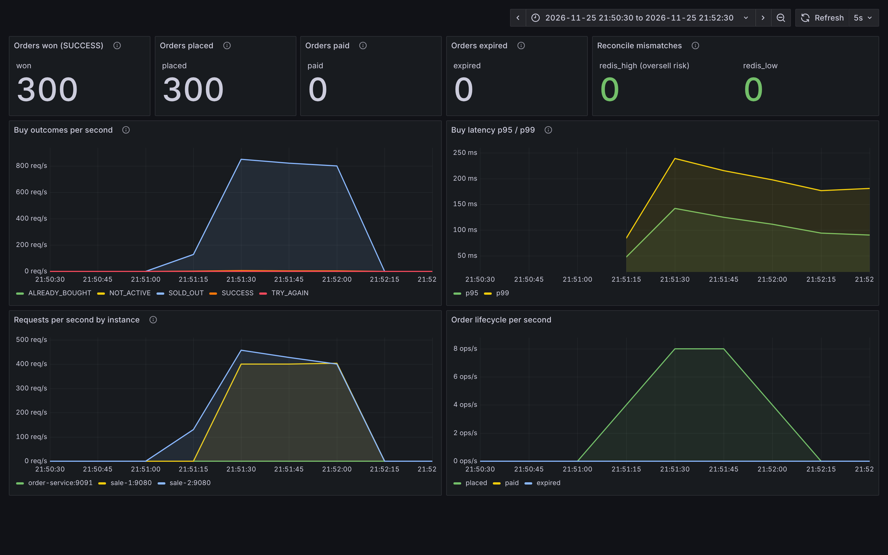

# Load test results

The Phase 4 acceptance test from [ARCHITECTURE.md](../ARCHITECTURE.md) §15, run three times in a row.

## Result

**20,000 buy attempts from 20,000 different users, 100 units of stock: exactly 100 winners in every run.**

| Run | Requests | Throughput | Won (202) | Sold out (410) | Errors (other / 5xx) | Latency p50 | p95 | p99 | Postgres orders | Redis stock after |
| :-: | -------: | ---------: | --------: | -------------: | -------------------: | ----------: | --: | --: | --------------: | ----------------: |
| 1 | 20,000 | 4,647 req/s | **100** | 19,900 | 0 | 121 ms | 476 ms | 581 ms | 100 `PENDING_PAYMENT` | 0 |
| 2 | 20,000 | 4,994 req/s | **100** | 19,900 | 0 | 98 ms | 425 ms | 559 ms | 100 `PENDING_PAYMENT` | 0 |
| 3 | 20,000 | 5,868 req/s | **100** | 19,900 | 0 | 108 ms | 321 ms | 455 ms | 100 `PENDING_PAYMENT` | 0 |

After each run, outside k6:

- `SELECT status, count(*) FROM orders WHERE sale_id=1 GROUP BY status` → `PENDING_PAYMENT | 100`.
- Redis `sale:1:stock` = `0`, `SCARD sale:1:buyers` = `100`.
- Prometheus agreed: `flashsale_buy_total{result="SUCCESS"}` and `flashsale_orders_placed_total` both rose by exactly 300 over the three runs; `flashsale_reconcile_mismatch_total` stayed at 0.
- Nginx split the buy traffic evenly between `sale-1` and `sale-2`.



The rate panels use a 30 s window, so each ~4 s run is smoothed into a wider, lower hump; k6's own numbers above are the precise throughput.

## Setup

| | |
| :-- | :-- |
| Scenario | k6 `shared-iterations`: 1000 VUs share 20,000 iterations; user id `__VU * 100000 + __ITER` (unique per attempt) |
| Script | [`loadtest/flash-sale.js`](../loadtest/flash-sale.js) — thresholds: `orders_won == 100`, `checks == 100 %`, `http_req_failed == 0`, `unexpected_status == 0` |
| Path | k6 → Nginx :8080 → `sale-1` / `sale-2` → Redis Lua + Kafka → order-service → PostgreSQL |
| Rate limits | Per-IP Nginx limit off (`docker-compose.loadtest.yml`; all k6 traffic is one IP). Per-user limit on. |
| Machine | One 4-vCPU Intel Xeon @ 2.1 GHz, 16 GB RAM, running **everything**: k6, Nginx, both sale-service JVMs, order-service, Redis, Kafka, PostgreSQL, Prometheus and Grafana |
| Versions | Java 17 (Temurin), Spring Boot 3.5.16, Redis 7.4.12, Kafka 3.8.0, PostgreSQL 16.16, Nginx 1.27.5, k6 1.2.0 |

Throughput and latency are limited by the shared 4-core machine (k6 alone generates 1000 concurrent connections), not by the design. The correctness result is what this test exists to prove; the latency numbers are a baseline, not a capacity claim.

## How to reproduce

```bash
cp .env.example .env                                   # once
(cd sale-service && ./mvnw -DskipTests package)
(cd order-service && ./mvnw -DskipTests package)
docker compose -f docker-compose.yml -f docker-compose.loadtest.yml up -d --build

curl -X POST localhost:8090/admin/sales/1/reset        # stock back to 100, orders wiped
sleep 6                                                # local sold-out flags clear every 5 s
docker run --rm -i --network host -v "$PWD/loadtest:/scripts:ro" grafana/k6:1.2.0 run /scripts/flash-sale.js

docker compose exec postgres psql -U postgres -d flashsale -c \
  "SELECT status, count(*) FROM orders WHERE sale_id=1 GROUP BY status"
docker compose exec redis redis-cli GET sale:1:stock
```

## What it took

The first attempt proved the core guarantee (exactly 100 winners) but failed the "no 5xx" check: under the burst, Nginx's 1 s connect timeout fired while Tomcat's 100-slot accept queue overflowed, and with `max_fails=1` Nginx took both instances out of rotation (`no live upstreams` → 502). The fix, now in the repo:

- Nginx reuses upstream connections (`keepalive 512`, `keepalive_requests 100000`) instead of opening a new TCP connection per request.
- Tomcat queues up to 1000 pending connections and keeps upstream connections alive (`accept-count`, `max-keep-alive-requests`).
- An instance is benched only after 3 failed connects, for 5 s, with a 2 s connect timeout.

## Raw k6 summaries

<details><summary>Run 1</summary>

```
█ THRESHOLDS

    checks
    ✓ 'rate==1.0' rate=100.00%

    http_req_failed
    ✓ 'rate==0' rate=0.00%

    orders_won
    ✓ 'count==100' count=100

    unexpected_status
    ✓ 'count==0' count=0


  █ TOTAL RESULTS

    checks_total.......: 20000   4646.750401/s
    checks_succeeded...: 100.00% 20000 out of 20000
    checks_failed......: 0.00%   0 out of 20000

    ✓ status < 500

    CUSTOM
    orders_won.....................: 100    23.233752/s
    sold_out.......................: 19900  4623.516649/s
    unexpected_status..............: 0      0/s

    HTTP
    http_req_duration..............: avg=171.15ms min=529.51µs med=120.67ms p(90)=401.51ms p(95)=476.47ms p(99)=580.99ms max=737.45ms
      { expected_response:true }...: avg=171.15ms min=529.51µs med=120.67ms p(90)=401.51ms p(95)=476.47ms p(99)=580.99ms max=737.45ms
    http_req_failed................: 0.00%  0 out of 20000
    http_reqs......................: 20000  4646.750401/s

    EXECUTION
    iteration_duration.............: avg=204.9ms  min=586.26µs med=150.68ms p(90)=463.98ms p(95)=548.12ms p(99)=695.39ms max=850.19ms
    iterations.....................: 20000  4646.750401/s
    vus............................: 1000   min=1000       max=1000
    vus_max........................: 1000   min=1000       max=1000

    NETWORK
    data_received..................: 3.7 MB 861 kB/s
    data_sent......................: 2.4 MB 566 kB/s
```
</details>

<details><summary>Run 2</summary>

```
█ THRESHOLDS

    checks
    ✓ 'rate==1.0' rate=100.00%

    http_req_failed
    ✓ 'rate==0' rate=0.00%

    orders_won
    ✓ 'count==100' count=100

    unexpected_status
    ✓ 'count==0' count=0


  █ TOTAL RESULTS

    checks_total.......: 20000   4994.070955/s
    checks_succeeded...: 100.00% 20000 out of 20000
    checks_failed......: 0.00%   0 out of 20000

    ✓ status < 500

    CUSTOM
    orders_won.....................: 100    24.970355/s
    sold_out.......................: 19900  4969.100601/s
    unexpected_status..............: 0      0/s

    HTTP
    http_req_duration..............: avg=144.63ms min=462.27µs med=98.36ms  p(90)=342.42ms p(95)=424.88ms p(99)=558.91ms max=1.03s
      { expected_response:true }...: avg=144.63ms min=462.27µs med=98.36ms  p(90)=342.42ms p(95)=424.88ms p(99)=558.91ms max=1.03s
    http_req_failed................: 0.00%  0 out of 20000
    http_reqs......................: 20000  4994.070955/s

    EXECUTION
    iteration_duration.............: avg=175.07ms min=516.84µs med=124.57ms p(90)=401.39ms p(95)=493.64ms p(99)=619.69ms max=1.08s
    iterations.....................: 20000  4994.070955/s
    vus............................: 1000   min=1000       max=1000
    vus_max........................: 1000   min=1000       max=1000

    NETWORK
    data_received..................: 3.7 MB 925 kB/s
    data_sent......................: 2.4 MB 609 kB/s
```
</details>

<details><summary>Run 3</summary>

```
█ THRESHOLDS

    checks
    ✓ 'rate==1.0' rate=100.00%

    http_req_failed
    ✓ 'rate==0' rate=0.00%

    orders_won
    ✓ 'count==100' count=100

    unexpected_status
    ✓ 'count==0' count=0


  █ TOTAL RESULTS

    checks_total.......: 20000   5868.017287/s
    checks_succeeded...: 100.00% 20000 out of 20000
    checks_failed......: 0.00%   0 out of 20000

    ✓ status < 500

    CUSTOM
    orders_won.....................: 100    29.340086/s
    sold_out.......................: 19900  5838.6772/s
    unexpected_status..............: 0      0/s

    HTTP
    http_req_duration..............: avg=129.86ms min=1.07ms med=108ms    p(90)=248.2ms  p(95)=320.66ms p(99)=454.57ms max=602.5ms
      { expected_response:true }...: avg=129.86ms min=1.07ms med=108ms    p(90)=248.2ms  p(95)=320.66ms p(99)=454.57ms max=602.5ms
    http_req_failed................: 0.00%  0 out of 20000
    http_reqs......................: 20000  5868.017287/s

    EXECUTION
    iteration_duration.............: avg=157.25ms min=1.12ms med=135.57ms p(90)=304.88ms p(95)=376.1ms  p(99)=487.43ms max=668.23ms
    iterations.....................: 20000  5868.017287/s
    vus............................: 1000   min=1000       max=1000
    vus_max........................: 1000   min=1000       max=1000

    NETWORK
    data_received..................: 3.7 MB 1.1 MB/s
    data_sent......................: 2.4 MB 715 kB/s
```
</details>
