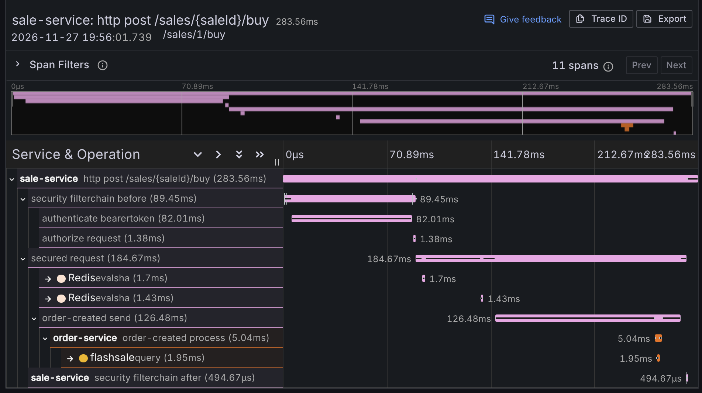
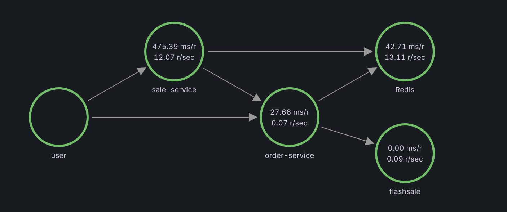

# Distributed tracing

Every purchase can be followed as **one timeline** across both services:

- the HTTP request and the JWT check;
- the two Redis scripts;
- the Kafka send;
- order-service processing the event;
- the database write.

The traces are produced with OpenTelemetry (Spring Boot 4's `spring-boot-starter-opentelemetry`), stored in Grafana Tempo, and viewed in Grafana.



The trace crosses Kafka because sale-service writes the trace context into a W3C `traceparent` header on the order event, and order-service continues from it. So the `order-created process` span and the `INSERT` under it belong to the buyer's trace.

Tempo also turns the traces into a live **service graph**: who calls whom, how often and how fast. You don't have to draw it by hand.



## What is traced

| Span | Where | Recorded attributes |
| :-- | :-- | :-- |
| `http post /sales/{saleId}/buy` | sale-service | route (template, not the id), status, outcome |
| `authenticate bearertoken`, `authorize request` | sale-service | none |
| `evalsha` ×2 | sale-service → Redis | the command only. **Never the keys**: the rate-limit key contains the user id. |
| `order-created send` | sale-service → Kafka | topic |
| `order-created process` | order-service | topic, partition, offset, consumer group |
| `query` | order-service → PostgreSQL | SQL text with `?` placeholders. **Never the values** (user id, order token). |

Order payment, the admin endpoints and the background jobs are traced the same way.

**No personal data in traces.** Spans leave the services, so they carry no user id, order token or event payload. `TracePropagationTest` sends an order event carrying a known trace id through a real Kafka broker, checks that the processing and the `INSERT` join that trace as children of the producer's span, and fails if the buyer's id or order token appears anywhere in the spans.

## Find a purchase

- **From the shop or curl.** Every response has an `X-Request-Id` header. The services' JSON logs carry both ids on every line: `"request_id":"…","traceId":"…"`.
```bash
docker compose logs sale-1 sale-2 | grep <request id> | grep -o '"traceId":"[0-9a-f]*' | head -1
```
  Paste the trace id into Grafana: **Explore → Tempo → TraceQL**.
- **Browse.** Use **Explore → Tempo → Search** (filter by service, span name or duration), or the **Service Graph** tab.
- **TraceQL examples:**
  - `{ resource.service.name = "order-service" && duration > 100ms }`: slow order writes.
  - `{ name = "http post /sales/{saleId}/buy" && span.status = "503" }`: buyers who were told to try again.

## Sampling: what tracing costs

A span for every request and every Redis call is not free. The flash-sale load test (20,000 buyers, 100 units) was run on one 4-vCPU machine at three sampling rates, alternating the runs:

| Sampling (`TRACING_SAMPLING`) | Requests/s | p95 | Unexpected answers | Winners |
| :-- | --: | --: | --: | --: |
| 0% (off) | 754 / 766 / 830 | 2.6 / 2.7 / 2.9 s | 0 / 0 / 0 | 100 each |
| **10%** | **736 / 817** | **2.7 / 2.4 s** | **0 / 0** | **100 each** |
| 100% | 633 / 665 | 3.3 / 3.4 s | 13 / 62 | 100 each |

**Tracing every request under a saturating burst cost about 14% throughput.** On the already saturated CPU, some Redis calls passed their 1 s timeout, and those buyers got a safe `503 TRY_AGAIN`. Correctness never changed: exactly 100 winners in every run. At **10%**, the cost was within run-to-run noise.

Settings:
- **Normal mode: 100%.** Traffic is low, and every purchase you make can be looked up.
- **Load-test mode** (`docker-compose.loadtest.yml`): **10%**. The chaos tests use it too.
- **For real traffic, use 1–10%.** Set `TRACING_SAMPLING` in `.env`, from 0.0 to 1.0.

These absolute numbers are lower than the README's headline figures because this machine was busier during these runs. Compare the rows with each other.

## Configuration

| Setting | Where | Default |
| :-- | :-- | :-- |
| `TRACING_EXPORT_ENABLED` | docker-compose.yml | `true` in Docker; `false` for local runs and tests, so nothing tries to reach a collector |
| `OTLP_TRACES_ENDPOINT` | docker-compose.yml | `http://tempo:4318/v1/traces` |
| `TRACING_SAMPLING` | `.env` | `1.0` (load-test mode: `0.1`) |

- **Tempo** (`infra/tempo/tempo.yaml`): one process, local disk, 24 h retention, OTLP over HTTP on 4318, and its query API on `127.0.0.1:3200`. Its metrics generator writes the service-graph and span metrics to Prometheus, which runs with `--web.enable-remote-write-receiver`.
- **Metrics stay pull-based** on `/actuator/prometheus`. The OpenTelemetry starter's OTLP metrics and log exporters are switched off.

## Limits

- **Nginx is not traced.** Traces start in sale-service. Nginx's own timing is in its JSON access log, linked by the request id.
- **Tempo here is a development setup**, not a production cluster: one process, local disk, 24 h retention, nothing replicated.
- **Sampling is decided per request at the start ("head" sampling).** Errors are not guaranteed to be kept at 10%. Tail sampling, which keeps every error and slow trace, needs an OpenTelemetry Collector in front of Tempo.
